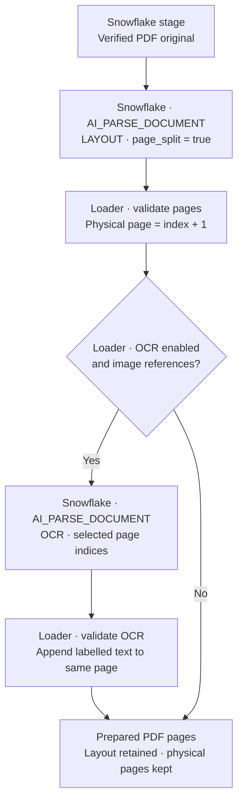
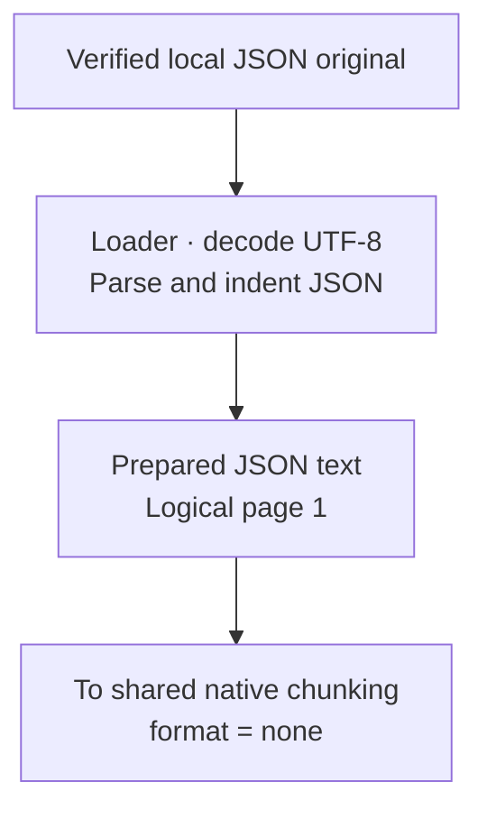
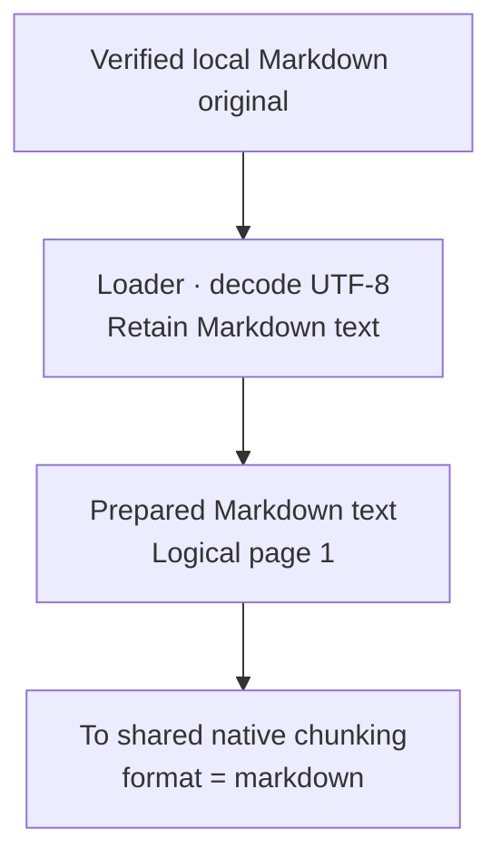
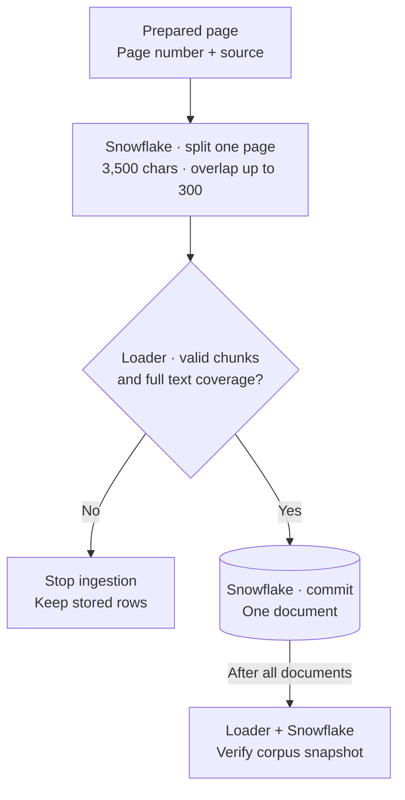

# How documents are ingested

The pipeline uses **`AI_PARSE_DOCUMENT` in `LAYOUT` mode for the seven PDFs**
and **Snowflake's recursive splitter for all 13 files**, preserving page
references. JSON and Markdown already contain text, so they need different
preparation before reaching the same splitter.

The diagrams describe this repository's supported pipeline. **Loader** means
the Python CLI running on your machine; **Snowflake** means a service or SQL
operation inside Snowflake. Arrows show the order in which data is prepared.

| Source type | Preparation | Page reference | Splitter format |
| --- | --- | --- | --- |
| [7 PDFs](#pdf-layout-and-selective-ocr) | Native LAYOUT parsing, with optional native OCR | Physical PDF page, starting at 1 | `markdown` |
| [5 JSON files](#json-text-from-structured-data) | Decode UTF-8, parse JSON and indent it | Logical page 1 per file | `none` |
| [1 Markdown file](#markdown-preserve-the-source-text) | Decode UTF-8, retain the Markdown | Logical page 1 | `markdown` |

## Before the paths separate

The loader downloads the complete recursive `data/` tree at the pinned Git
commit. It checks each file's Git blob hash and size, records its SHA-256 hash,
and retains the original folder paths. An unsupported file type stops the load.

During ingestion, each original is uploaded to an internal Snowflake stage,
downloaded again, and checked against its source bytes. PDFs are parsed from
that stage. JSON and Markdown text is prepared from the verified local copies;
their staged originals remain available as evidence too.

## PDF: layout and selective OCR

LAYOUT produces Markdown text with document structure, including tables.
`page_split=true` keeps physical pages separate. The loader checks the returned
page metadata and converts Snowflake's zero-based indices to page numbers
starting at 1. A cover page therefore counts as page 1, regardless of printed
page labels.

`native_ocr=true` is the default. The loader looks for image references in the
LAYOUT output and sends only those page indices through a second
[`AI_PARSE_DOCUMENT`](https://docs.snowflake.com/en/sql-reference/functions/ai_parse_document)
call in OCR mode. It keeps the layout text and appends a labelled OCR section to
the **same physical page**. Pages without image references keep their layout
text alone. Setting `native_ocr=false` skips this enrichment.

OCR recovers printed text and labels. It does not establish chart values,
arrow directions or other visual relationships. The original PDF remains the
source for checking those details. Raw LAYOUT and OCR responses retain separate
query IDs and hashes, so reviewers can distinguish their contributions.

## JSON: text from structured data

Each JSON file becomes one logical page of indented text. The loader parses
the JSON to validate its syntax and formats it with two-space indentation,
preserving Unicode characters. It does not turn JSON records into table rows.

All five JSON files follow this path, including `Json_Examples/query.json`.
Example queries are stored as source text and **never executed**. That file is
marked `KIND=query_example`; the agent is instructed to exclude it from factual
policy evidence. The other four files use `KIND=json_example`.

## Markdown: preserve the source text

The loader decodes `Zava_Company_Overview.md` as UTF-8 and keeps the Markdown
text unchanged. Headings and lists reach Snowflake's splitter as Markdown.
The entire file is logical page 1, even if it later produces several chunks.

## Shared chunking and storage

Every file type now has the same shape: numbered pages of text, linked to an
original file. Snowflake runs
[`SNOWFLAKE.CORTEX.SPLIT_TEXT_RECURSIVE_CHARACTER`](https://docs.snowflake.com/en/sql-reference/functions/split_text_recursive_character-snowflake-cortex)
on **each page separately**, using a 3,500-character limit and up to 300
characters of overlap. This native splitter is deterministic; AI parsing is the
PDF preparation step.

Each successful transaction writes that document's metadata to
`CORPUS.DOCUMENTS`, its page text to `CORPUS.PAGES`, and its search passages to
`CORPUS.CHUNKS`.

The loader checks page numbers, chunk order, size and complete text coverage,
ignoring whitespace when reconstructing each prepared page. It rejects gaps or
altered content and does not repair native output locally. Parsing or splitting
failures stop the load before that document's corpus rows are replaced; earlier
documents may already have committed. A database write failure rolls back that
document's transaction.

Each chunk carries its document ID, source path, source URL, Git commit, file
hash, snapshot ID and page number. For example, every chunk from
`Benefit_Options.pdf` physical page 4 keeps `PAGE_NUMBER=4`. Chunks never combine
two PDF pages. JSON and Markdown chunks keep `PAGE_NUMBER=1`; this is a logical
reference, not a line number.

The [pinned corpus](../reference/corpus.md) produced 273 physical PDF pages plus
six logical text pages: **279 pages in total**. The measured native run produced
281 chunks. Counts can change when the source or parsing configuration changes;
they are observations of that snapshot, not fixed splitter guarantees.

## Reuse and the handoff to search

On an unchanged rerun, the loader checks staged original bytes again and reuses
completed documents in the same snapshot. Those documents skip parsing,
chunking and table inserts. When a document still needs loading, a valid PDF
parse cache can avoid another AI call. Cached output must match its source hash
and pipeline identity. The diagrams show preparation when fresh output is needed.

`deploy` verifies the corpus, creates or reuses Cortex Search over that snapshot's
chunks, checks retrieval for every source, then creates or updates the agent.
The subsequent `verify` command compares the **entire index** with the stored
chunks, including text and provenance. This exact index audit happens after
deployment.

Successful ingestion prepares the corpus evidence; deployment and index
verification check that Search can retrieve it. To recognize Analytical
Search in an answer, inspect the agent's successful search and native SQL tool
results, as explained in [architecture and evidence](architecture.md#ordinary-retrieval-and-analytical-questions).
Current runtime and answer-quality limits remain in
[capabilities and limits](../reference/capabilities.md).
